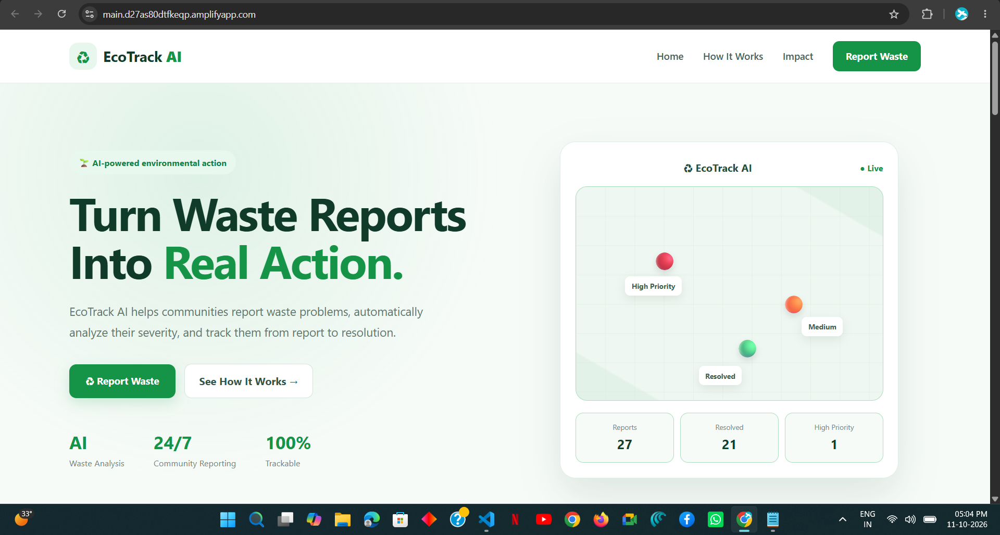
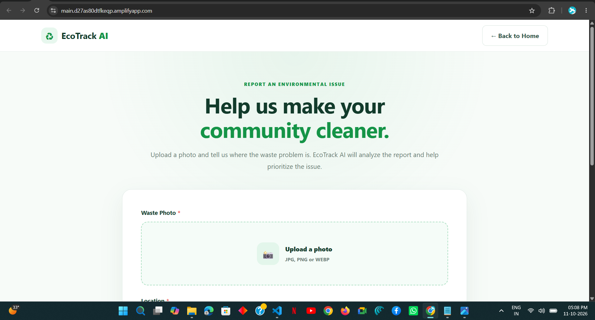
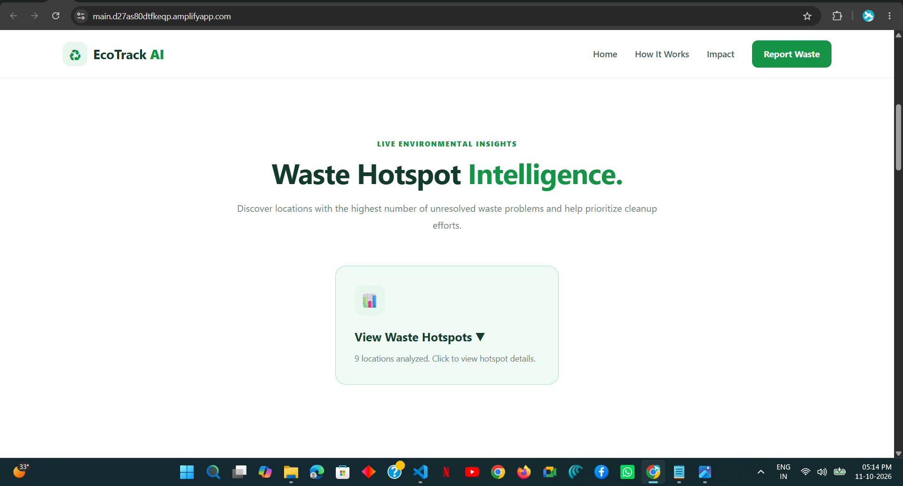
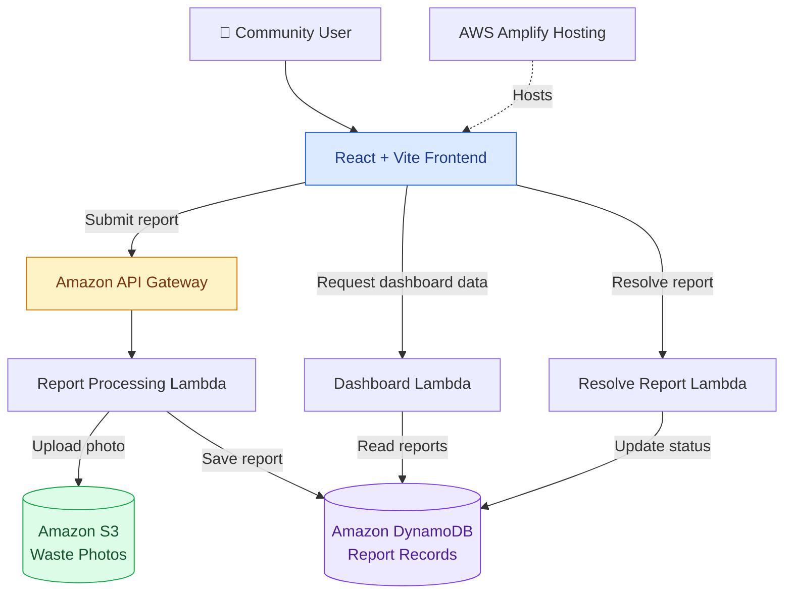
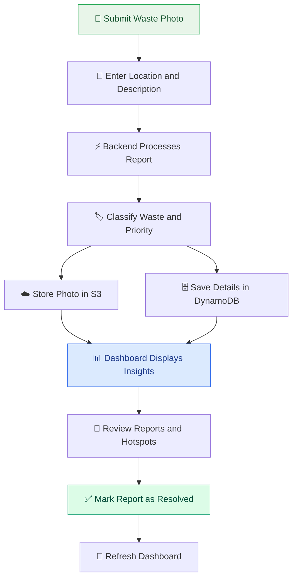

# 🌱 EcoTrack AI

### Turn Waste Reports Into Real Action.

**An AWS-powered environmental reporting platform for identifying waste problems, assessing cleanup priorities, and tracking resolution.**

<p align="center">
  <a href="https://main.d27as80dtfkeqp.amplifyapp.com/">
    🌐 <strong>Live Demo</strong>
  </a>
  &nbsp; • &nbsp;
  <a href="https://github.com/aditya052003/ecotrack-ai">
    💻 <strong>GitHub Repository</strong>
  </a>
</p>

---

## 🌍 About the Project

Waste problems in public spaces can go unreported, remain unresolved, or be difficult to prioritize. Communities need a simple way to document these issues and monitor cleanup progress.

**EcoTrack AI** is a web-based environmental reporting platform that allows users to submit waste reports with photos, locations, and descriptions. The backend processes each report, assigns a waste category and priority using implemented classification rules, and stores the information in AWS.

The dashboard presents report statistics, waste categories, location-based hotspot insights, and resolution status to help users understand where environmental attention may be needed.

### 🎯 Our Mission

Make waste reporting easier, improve visibility into local waste problems, and help communities take informed action toward cleaner surroundings.

---

## ✨ Key Features

| Feature | Description |
|---|---|
| 📸 Waste Reporting | Submit waste photos with a location and description. |
| ♻️ Waste Classification | Categorize reports into hazardous, electronic, plastic, organic, and general waste using implemented rules. |
| 🚨 Priority Assessment | Assign High, Medium, or Low priority based on report descriptions and classification rules. |
| ☁️ Cloud Photo Storage | Store submitted photos in Amazon S3. |
| 🗄️ Report Database | Store report details, classification, priority, and status in Amazon DynamoDB. |
| 📊 Live Dashboard | View report totals, resolved reports, priority statistics, and waste-category distribution. |
| 📍 Hotspot Intelligence | Summarize reported waste issues by location and highlight potential cleanup priorities. |
| ✅ Resolution Tracking | Mark submitted reports as resolved and update their status. |
| 🔄 Automatic Refresh | Periodically refresh dashboard data to reflect changes. |

---

## 🖥️ Live Application

**Try EcoTrack AI:** https://main.d27as80dtfkeqp.amplifyapp.com/

## 📸 Application Screenshots

### 🏠 Home Page


### 📝 Waste Reporting


### 📊 Dashboard Insights



The application supports the following workflow:

1. Submit a waste report with a photo, location, and description.
2. Process the report through the backend.
3. Classify the waste type and priority.
4. Store the photo and report details in AWS.
5. Review dashboard statistics and location-based insights.
6. Mark a report as resolved and track cleanup progress.

---

## 🏗️ System Architecture

EcoTrack AI uses a serverless AWS backend with a React frontend hosted on AWS Amplify.



### 🔄 Report Lifecycle

This diagram explains how a report moves through the application, from submission to resolution.



---

## 🛠️ Technology Stack

### Frontend

- **React** — component-based user interface
- **Vite** — development server and build tooling
- **JavaScript** — application logic
- **CSS** — layout, styling, and responsive presentation

### AWS Cloud Services

- **AWS Amplify Hosting** — deploy and host the frontend
- **Amazon API Gateway** — expose HTTP endpoints for backend operations
- **AWS Lambda** — serverless report processing, dashboard retrieval, and resolution operations
- **Amazon S3** — store waste-report photos
- **Amazon DynamoDB** — persist report records and their statuses

### Development Tools

- Git
- GitHub
- Visual Studio Code
- npm

---

## 🧠 Waste Classification and Priority

EcoTrack AI currently uses **rule-based classification** to evaluate report descriptions.

Examples of the intended behavior include:

| Example Description | Expected Category | Expected Priority |
|---|---|---|
| Large amount of chemical waste | Hazardous Waste | High |
| Battery dumped in a public area | Electronic Waste | High |
| Plastic bottles scattered on a road | Plastic Waste | Medium |
| Food scraps | Organic Waste | Low |

The exact result depends on the implemented keywords and rule ordering. These examples illustrate intended behavior, not a guarantee that every similar description will produce the same result.

**Current limitation:** Classification is based on report text, not automated image recognition. Amazon Bedrock inference is not currently available in the deployed workflow, so the project should not be described as using active Bedrock-based AI inference.

---

## 🚀 Getting Started

You can run the frontend locally for development.

### Prerequisites

Install the following:

- [Node.js](https://nodejs.org/)
- npm, included with Node.js
- [Git](https://git-scm.com/)
- A code editor such as Visual Studio Code

### 1. Clone the Repository

```bash
git clone https://github.com/aditya052003/ecotrack-ai.git
```

### 2. Navigate to the Project

```bash
cd ecotrack-ai
```

### 3. Install Dependencies

```bash
npm install
```

### 4. Start the Development Server

```bash
npm run dev
```

Open the local address displayed in your terminal. With the default Vite configuration, this is commonly:

```text
http://localhost:5173
```

### 5. Build for Production

To verify that the frontend builds successfully, run:

```bash
npm run build
```

Vite will generate the production build in the `dist` directory.

> **Note:** Running the frontend locally does not automatically configure the AWS backend. Report submission and dashboard features require the appropriate API endpoints, AWS resources, permissions, and frontend configuration.

---

## 📂 Project Structure

The repository uses a React + Vite structure similar to the following:

```text
ecotrack-ai/
├── public/
├── src/
│   ├── assets/
│   ├── App.css
│   ├── App.jsx
│   ├── index.css
│   └── main.jsx
├── .gitignore
├── index.html
├── package.json
├── package-lock.json
├── README.md
└── vite.config.js
```

The `src` directory contains the frontend application and its styling. The backend services are configured separately in AWS.

---

## 🌱 Environmental Impact

EcoTrack AI aims to support community-led environmental action by:

- Making it easier to document waste issues.
- Improving visibility into reported waste problems.
- Highlighting locations that may require cleanup attention.
- Tracking progress from report submission to resolution.
- Providing a foundation for future environmental analytics.

The platform supports reporting and tracking; actual cleanup depends on community members or responsible authorities taking action.

---

## 🔮 Future Enhancements

Potential improvements include:

- 🤖 AI-powered image analysis when model access is available.
- 🗺️ Interactive maps with geographic hotspot visualization.
- 🔔 Notifications for high-priority reports.
- 📈 Advanced cleanup analytics and historical trends.
- 🔐 Authentication and role-based access for users and cleanup teams.
- 🧪 More comprehensive classification tests and configurable risk rules.
- 🌐 Expanded location support and improved data validation.

---

## 👨‍💻 Developer

**Aditya Raut**

B.Tech — Computer Science and Engineering

- **GitHub:** [@aditya052003](https://github.com/aditya052003)
- **Project:** [EcoTrack AI Repository](https://github.com/aditya052003/ecotrack-ai)
- **Live Demo:** [Open EcoTrack AI](https://main.d27as80dtfkeqp.amplifyapp.com/)

---

<p align="center">
  🌿 <strong>Small actions. Cleaner communities. A better environment.</strong>
</p>

<p align="center">
  Built to make environmental reporting more accessible and cleanup progress more visible.
</p>